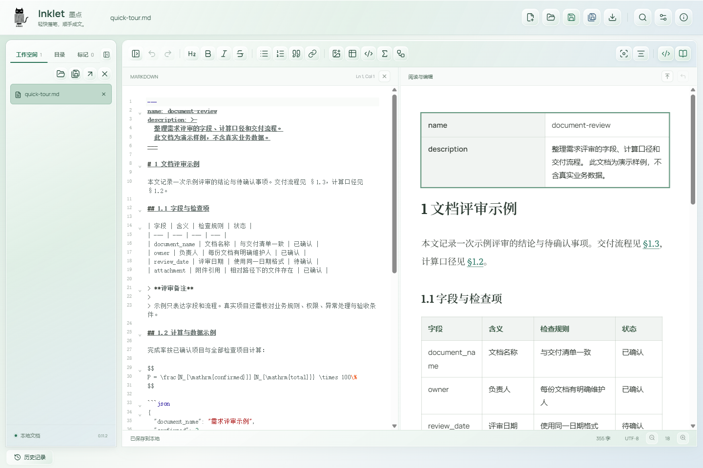
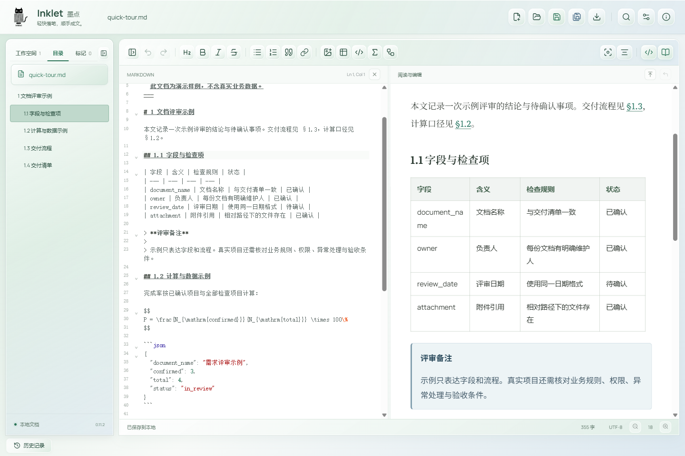
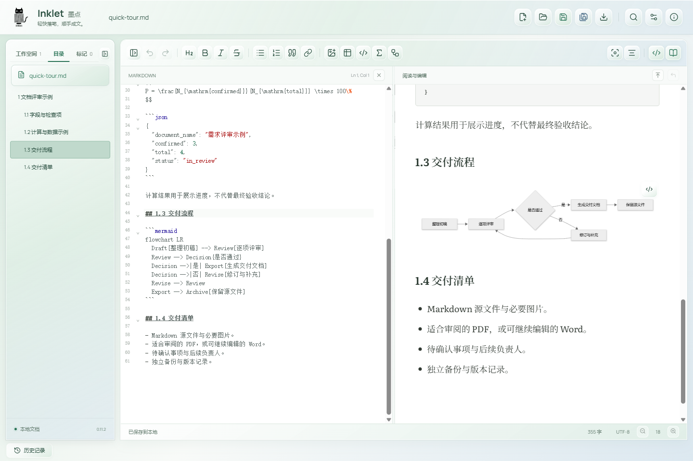

# Inklet 墨点 · Windows


> 轻快落笔，顺手成文。

**一款免费、开源、本地运行的 Markdown 编辑器。** 源码与可视编辑放在同一个窗口，写笔记、读长文、检查表格，再导出一份可以交付的文档。

Windows 10/11 x64 · MIT · 当前版本 **v0.11.3 体验版**

[效果示例](#效果示例) · [下载安装](#下载安装) · [使用场景](#使用场景) · [功能一览](#功能一览) · [使用边界](#使用边界) · [从源码构建](#从源码构建) · [反馈与贡献](#反馈与贡献)

不需要注册账号，不需要部署服务器。文档仍是你自己的 `.md` 文件，可以交给 Git 管理，也可以继续用其他编辑器打开。

## v0.11.3 更新

- 保留源码单换行，A/B/C 等连续编号说明各自起行，不擅自改成数字列表。
- 明确的图片占位引用显示占位框，保存和导出时保留占位表达，不把它当作不存在的图片读取。
- 开启图片内嵌后，真实图片读取、转换失败或内嵌超限会列出原因；可以返回检查，或确认保留原引用后保存正文及其他可用图片。
- 文档本身超限、磁盘写入失败、外部文件冲突和确认期间内容变化仍会阻止保存，避免假成功或覆盖数据。

## 效果示例

下面是 Windows 普通版 **0.11.2 实际运行截图**，展示仓库中的 [演示文档](examples/quick-tour.md)，不是设计效果图。截图只改变阅读位置，没有修改源文件。



## 使用场景

### 从 AI 生成的 Markdown 到可交付文档

一段回答里同时有标题、表格、公式和流程图，复制成纯文本后很难检查。把内容保存成 Markdown，在 Inklet 中一边查看源码，一边检查渲染结果；确认后导出 HTML、PDF 或 Word。

```text
Markdown 初稿
  -> 检查标题、表格与图表
  -> 修改正文和标注重点
  -> 导出 HTML / PDF / DOCX
```

Inklet 负责编辑、显示和导出，**不是 AI 生成器**，不会替你判断事实是否正确。

### 长需求、操作手册和字段表

读到哪一节，目录就跟到哪一节。搜索可以按章节显示命中位置；正文中的 `§1.3` 等有效编号引用，可以跳到对应的唯一编号标题。

宽表在内部横向滚动。搜索、列宽重算和离屏后返回时，会保留原来的横向位置；大文档只加载附近的表格，不要求一次把所有表格都铺开。



### 阅读和维护 SKILL.md

文档开头合法的 YAML 元数据以属性表显示，`name`、`description` 和多行说明按属性分行，正文继续正常渲染。

```yaml
---
name: document-review
description: >-
  检查需求文档中的字段、流程与待确认事项。
---
```

属性表只读，修改元数据时使用源码栏。仅编辑正文时，未编辑头部的引号、注释和换行格式会保留。**能编辑 Skill 文件，不代表 Inklet 会安装或执行 Skill。**

### 直接试一份完整示例

用 Inklet 打开 [examples/quick-tour.md](examples/quick-tour.md)。这是一份原创演示文档，包含 YAML 头部、字段表、备注、编号引用、代码、公式和 Mermaid 流程图，没有真实客户或业务数据。



## 下载安装

### 直接使用，不需要开发环境

1. 打开 [v0.11.3 发布页](https://github.com/VincentZhang-code/inklet-windows/releases/tag/v0.11.3)，下载 `Inklet-0.11.3-Windows-x64.zip`。普通版约 **4.6 MB**，不含系统运行时。
2. 完整解压 ZIP，保留目录中的所有文件，再运行 `Inklet.exe`。不要只复制 EXE，也不要直接在压缩包里运行。
3. 打开自己的 Markdown 文件，或先用演示文档试用。顶部提供保存、另存为和导出，源码区与可视区均可编辑。

[直接下载 Windows x64 ZIP](https://github.com/VincentZhang-code/inklet-windows/releases/download/v0.11.3/Inklet-0.11.3-Windows-x64.zip) · [所有版本](https://github.com/VincentZhang-code/inklet-windows/releases) · [简明使用说明](QUICKSTART.md)

| 环境 | 要求 |
| --- | --- |
| 操作系统 | Windows 10 / 11，x64 |
| .NET | .NET Framework 4.7.2 或更新版本 |
| 页面运行时 | Microsoft Edge WebView2 Runtime |
| 普通使用 | 不需要 Node.js、Python、Git 或账号 |
| 网络 | 程序资源随包提供；首次补装系统运行时、下载更新或构建依赖时需要网络 |

WebView2 Runtime 和普通 Edge 浏览器不是同一个安装项。缺少运行时时，请通过 [微软 WebView2 官方页面](https://developer.microsoft.com/microsoft-edge/webview2/)安装。

**当前程序未签名，Windows 可能提示“未知发布者”。** 请从本仓库 Release 获取文件并核验校验值，不要关闭系统安全检查。体验版仍需在实际环境中验证，不建议作为重要文档的唯一存储位置。

### 核验 ZIP 的 SHA-256

同时下载发布页中的 `SHA256SUMS.txt`，在下载目录运行：

```powershell
Get-FileHash .\Inklet-0.11.3-Windows-x64.zip -Algorithm SHA256
```

将输出与该发布版本的校验文件比较。校验值用于确认文件一致性，不等于代码签名，也不代表没有缺陷。

升级前先保存文档并退出旧版所有窗口，再使用新版完整目录。不要为了升级而删除本机设置、历史记录或草稿目录。当前没有自动更新服务。

## 功能一览

| 能力 | 当前支持 |
| --- | --- |
| 双栏编辑 | Markdown 源码与可视编辑，可并排，也可分别关闭；按对应内容同步滚动 |
| 日常写作 | 标题、粗体、斜体、删除线、列表、引用、链接、代码高亮、撤销与重做 |
| 文档导航 | 可拖宽目录、当前章节高亮、正文目录、编号引用跳转、查找替换与按节分组结果 |
| 表格 | Markdown 表格、受控 HTML 合并表格、增删行列、手动列宽、宽表内部滚动 |
| 元数据 | 文首合法 YAML 映射显示为只读属性表，适用于 SKILL.md 等文档 |
| 图片 | 按本地引用读取图片、插入与预览；可选择保存含内嵌图片的 Markdown |
| 公式与图表 | MathJax 数学公式、Mermaid 图表；图表可放大、缩放和平移查看 |
| 多文档 | 同窗工作空间、文件切换、保存全部、逐份关闭；可按设置打开独立窗口或拖出分窗 |
| 阅读体验 | 字体、字号、行距、段距、阅读宽度、独立明暗背景、专注与打字机模式 |
| 阅读进度 | 按文件记录位置，手动回到上次位置；打开时自动恢复可选，默认关闭 |
| 本地保护 | 保存备份、未保存草稿恢复、外部修改检测与冲突提示 |
| 文档导出 | HTML、PDF、Word（DOCX），处理本地图片、公式和流程图 |

### 三种导出，各有用途

| 格式 | 适合怎样交付 | 需要知道的区别 |
| --- | --- | --- |
| HTML | 在浏览器阅读或分发 | 可携带文档中的本地图片；独立于编辑器界面 |
| PDF | 审阅、打印、固定版式交付 | 按 A4 页面排版，不是当前屏幕截图；分页可能与编辑区不同 |
| DOCX | 交给还要继续编辑的人 | 正文与表格可编辑；公式和图表以图片形式嵌入 |

导出正文不包含软件工具栏或作者联系方式。浏览器和 Word 的字体、分页机制不同，不承诺逐像素一致。

## 文档如何保留在本地

Inklet 不要求把 Markdown 放进专有数据库。常规保存仍写回 Markdown；图片默认使用本地引用，其他编辑器可以继续读取这些文件。

- **打开和阅读不等于改写。** 自动表格布局、属性表显示、目录高亮和章节链接是显示行为，不会作为新格式写回正文。
- **正文修改尽量限定在改动处。** 支持范围内保留未编辑片段和原有 BOM、CRLF；被编辑的 Markdown 片段仍可能规范化。
- **图片内嵌是主动选择。** “保存时内嵌图片到 MD”默认关闭；开启后保存会增大文件，不会因为阅读一篇文档就自动嵌入图片。
- **图片问题由你决定。** 明确占位直接保留；真实图片内嵌失败时可确认保留原引用后保存正文，取消则不落盘，不静默丢弃图片。
- **外部修改先检查冲突。** 磁盘更新与本地编辑冲突时，需要选择处理方式，不以旧页面静默覆盖新内容。
- **草稿不是备份的替代品。** 恢复依赖已经确认落盘的记录，无法保证恢复异常退出前的每一个按键。

应用自身没有文档上传、账号注册或遥测服务。不自动下载 Markdown 中的 HTTP 图片；“本地运行”也不代表你的操作系统、云盘同步软件或第三方运行时完全不联网。

## 使用边界

把支持范围说清楚，比把“全兼容”写在介绍里更重要。

- 当前发布面向 **Windows x64**，本仓库不提供 Android 或 macOS 安装包。
- 单个 Markdown 文件限制为 **24 MiB**；内嵌图片也计入文件大小。超大文档仍受本机内存和 WebView2 资源限制。
- 不保证兼容所有 Markdown 扩展、复杂嵌套 HTML 或任意 CSS；HTML 表格按受控规则解析，不执行文档内脚本。
- 开启图片内嵌后，部分 Markdown 阅读器可能无法显示；某些图像格式会转换，需保留原始图片。
- Word 中的公式与流程图不是原生公式对象或可继续编辑的 Mermaid 图，仍需保留 Markdown 源文件。
- 中文输入法、复杂文档、文件监听和长期使用仍需要持续验证；不承诺零崩溃、零丢失或无限文档无开销。
- 这是 Markdown 编辑器，不是 AI Agent、云笔记、实时多人协作工具或完整 Office 套件。

## 验证情况

以下是 **v0.11.3 的本机验证与注明版本的既有基线**，不是所有电脑、输入法和文档的兼容保证。

| 已执行检查 | 结果与范围 |
| --- | --- |
| Markdown / Word 专项 | 47 项通过，包含源码换行、占位引用、缺图保留和导出 |
| 图片与换行交互 | 4 项通过，覆盖分行显示、保存取消/确认及导出提示 |
| 原生测试基线（v0.11.2） | 111 项通过，覆盖文件、编码、备份、恢复、工作空间和路径边界等 |
| 普通版实际 EXE 回归 | 38 项通过，包含保存、导出、外部修改、恢复和导航 |
| 大表专项 | 约 61 万字符、25 张 16 列宽表，搜索与离屏返回后横向位置保持，原文未变 |
| 发布附件 | 匿名下载与 SHA-256 核验通过；发布包中的 EXE 和资源包与已测试文件一致 |

本轮原生鼠标拖宽专项未通过，没有计入通过结果；不将相关性未确认的自动化失败宣称已修复。

仓库保留必要的核心与原生测试代码，不提交测试浏览器配置、临时业务样本、历史二进制和大体积验证缓存。

## 从源码构建

普通使用请直接下载安装包。只有修改源码、运行测试或自行构建时，才需要下面的开发环境。

准备 Windows、Node.js 24 LTS（含 npm），以及系统自带的 .NET Framework 编译器。在用于存放项目的目录中打开 Windows PowerShell：

```powershell
git clone https://github.com/VincentZhang-code/inklet-windows.git
cd inklet-windows

.\tools\bootstrap.ps1
npm --prefix app test
.\tools\test-native.ps1
.\tools\build.ps1
```

`bootstrap.ps1` 通过 `npm ci` 安装锁文件中的依赖，并下载固定版本 WebView2 SDK `1.0.2903.40`。首次准备需要网络；前端图片和图标已经随源码提供，构建不需要启动浏览器。

生成的程序目录与便携 ZIP 位于 `release/`。SDK、`node_modules`、构建输出及测试临时数据均在 Git 忽略范围内。

如果系统策略阻止执行 PowerShell 脚本，请遵守设备管理策略，不要为了构建而绕过企业安全控制。

## 工作原理

```text
Windows 桌面窗口（WinForms + WebView2）
  -> 编辑界面（CodeMirror + ProseMirror）
  -> Markdown 解析、导航与显示（markdown-it）
  -> 本地文件、保存检查、恢复与导出
```

前端使用 Vite 构建。公式由 MathJax 渲染，流程图由 Mermaid 渲染，Word 导出使用 docx。第三方组件各自的许可声明保留在 `licenses/`，不将这些能力描述为从零自研。

### 仓库结构

```text
inklet-windows/
  app/          前端界面、锁定依赖与核心前端测试
  core/         文档状态、搜索、恢复等共享逻辑及测试
  native/       Windows 宿主、文件服务与原生测试
  tools/        依赖准备、构建和测试入口
  assets/       应用 Logo 与图标
  examples/     可直接打开的演示文档
  licenses/     第三方许可声明
  QUICKSTART.md 简明使用说明
  LICENSE       MIT 许可证
```

## 常见问题

**为什么下载包只有几 MB？是不是还要联网加载编辑器？**

编辑器的前端资源随包提供。包体小的主要原因是复用本机 WebView2 和 .NET Framework，没有再打包一套完整浏览器；缺少系统运行时仍需先安装。

**能否设为 Windows 的 Markdown 默认打开程序？**

可以在阅读设置中使用“Markdown 默认打开方式”入口，再由你在 Windows 设置中选择。程序不直接改写受保护的默认应用选择。

**为什么属性表不能直接点进去改 name、description？**

属性表用于阅读。需要修改 YAML 时，在源码栏编辑，以便明确处理引号、多行值和缩进。

**普通图片引用和“内嵌图片到 MD”怎么选？**

长期编辑、用 Git 管理时可保留图片文件与相对路径；希望只携带一份 MD 时可考虑内嵌，但要留意文件体积和其他阅读器的兼容性。

**免费和开源是否意味着所有资源都没有使用限制？**

项目源码采用 MIT。第三方库和资源仍遵守各自许可；源码许可不授予商标权，也不改变你处理的文档本身的版权。

## 反馈与贡献

遇到问题或有改进建议，请到 [Issues](https://github.com/VincentZhang-code/inklet-windows/issues) 描述场景。欢迎通过 [Pull Requests](https://github.com/VincentZhang-code/inklet-windows/pulls) 提交修复、文档改进和有针对性的回归测试。

提交问题时，尽量提供：

- Inklet 版本、Windows 版本和 WebView2 版本。
- 预期结果、实际结果，以及最短复现步骤。
- 能复现问题的最小 Markdown 片段或脱敏副本。
- 必要的截图、错误信息和相关日志。

**不要上传客户资料、内部需求、账号令牌或未脱敏日志。** 涉及私密内容或安全问题时，可先通过下方作者联系方式沟通。提出较大功能改动前，先开 Issue 对齐范围，避免做了大量实现后才发现目标不同。

## 关于作者

作者：达芬奇Vincent。

| 渠道 | 地址 |
| --- | --- |
| GitHub | [VincentZhang-code](https://github.com/VincentZhang-code) |
| 微信 | `seveniear_7` |

Inklet 的重点是把本地 Markdown 的编辑、阅读和交付接起来。欢迎带着具体使用场景参与改进，提供可复现的问题，帮助定位缺陷和验证修复。

## 许可证

项目源码使用 [MIT License](LICENSE)，允许在遵守许可条件的前提下使用、修改与再分发。第三方组件保留 [licenses/](licenses/) 中的各自声明。

## English

**Inklet is a free, MIT-licensed Markdown editor for Windows.** It combines source and visual editing, large-table reading, a synchronized outline, local images, math, Mermaid and HTML/PDF/DOCX export.

Download the ordinary Windows x64 ZIP from [Releases](https://github.com/VincentZhang-code/inklet-windows/releases). Windows 10/11 x64, .NET Framework 4.7.2+ and Microsoft Edge WebView2 Runtime are required. No account, server or developer tools are needed for ordinary use.

The current unsigned build is an early preview. Keep backups, verify release checksums, and do not assume full Markdown compatibility or zero data loss. Project sources use MIT; third-party notices remain under `licenses/`.
