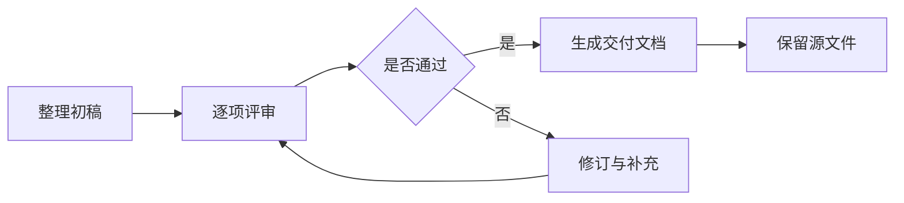

# 1 文档评审示例

本文记录一次示例评审的结论与待确认事项。交付流程见 §1.3，计算口径见 §1.2。

## 1.1 字段与检查项

| 字段 | 含义 | 检查规则 | 状态 |
| --- | --- | --- | --- |
| document_name | 文档名称 | 与交付清单一致 | 已确认 |
| owner | 负责人 | 每份文档有明确维护人 | 已确认 |
| review_date | 评审日期 | 使用同一日期格式 | 待确认 |
| attachment | 附件引用 | 相对路径下的文件存在 | 已确认 |

> **评审备注**
>
> 示例只表达字段和流程。真实项目还需核对业务规则、权限、异常处理与验收条件。

## 1.2 计算与数据示例

完成率按已确认项目与全部检查项目计算：

$$
P = \frac{N_{\mathrm{confirmed}}}{N_{\mathrm{total}}} \times 100\%
$$

```json
{
  "document_name": "需求评审示例",
  "confirmed": 3,
  "total": 4,
  "status": "in_review"
}
```

计算结果用于展示进度，不代替最终验收结论。

## 1.3 交付流程



## 1.4 交付清单

- Markdown 源文件与必要图片。
- 适合审阅的 PDF，或可继续编辑的 Word。
- 待确认事项与后续负责人。
- 独立备份与版本记录。
